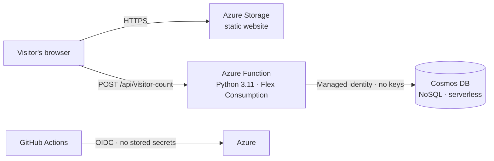

# Cloud Resume Challenge (Azure) — Frontend

**Live site:** https://stresumelvoc8r.z1.web.core.windows.net/

My resume as a static website on Azure, built for the [Cloud Resume Challenge](https://cloudresumechallenge.dev/docs/the-challenge/azure/). The visitor counter API lives in [resume-backend](https://github.com/Dlenz4321/resume-backend).

## Architecture



## What's in this repo

```
site/                 HTML, CSS, and counter.js (calls the API, shows the count)
infra/                Terraform: storage account, static website, upload permission
.github/workflows/    CI/CD pipeline
```

## How a change gets deployed

1. **Pull request:** GitHub Actions runs `terraform fmt`, `validate`, and `plan`, so I can review exactly what would change.
2. **Merge to main:** the `apply` job pauses for **my approval** (GitHub `production` environment).
3. **After approval:** Terraform applies, then the pipeline uploads `site/` to the `$web` container.

## Security decisions

- **No stored cloud credentials.** GitHub Actions signs in to Azure with OIDC (workload identity federation). Azure trusts tokens only from this repo, for pull requests or the `production` environment.
- **Least privilege.** The pipeline identity is Contributor on one resource group, not the subscription. Its permission to grant roles is limited by an Azure ABAC condition to a short list of data roles, so it can't make itself Owner.
- **Protected Terraform state.** State lives in Azure Storage with Entra ID auth, shared keys disabled, blob versioning, and 14-day soft delete.
- **Human approval gate** on every production change.

## Tech

Azure Storage (static website) · Terraform (azurerm 4.x, remote state) · GitHub Actions · OIDC · HTML/CSS/JavaScript

## Roadmap

- Custom domain with HTTPS through Cloudflare
- End-to-end smoke test after each deploy
